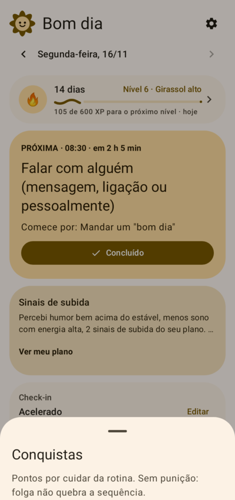
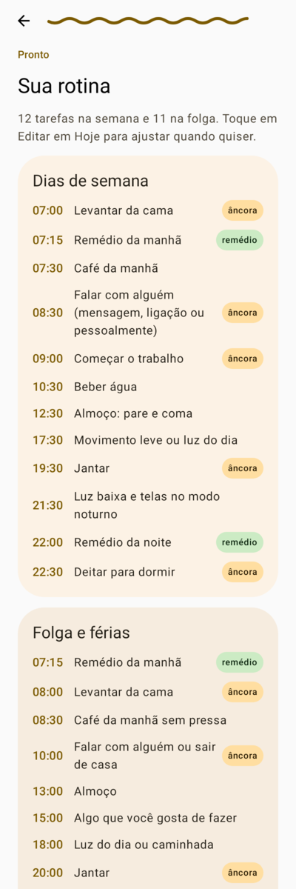
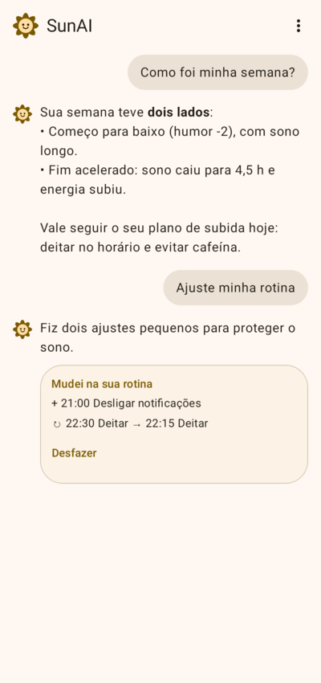
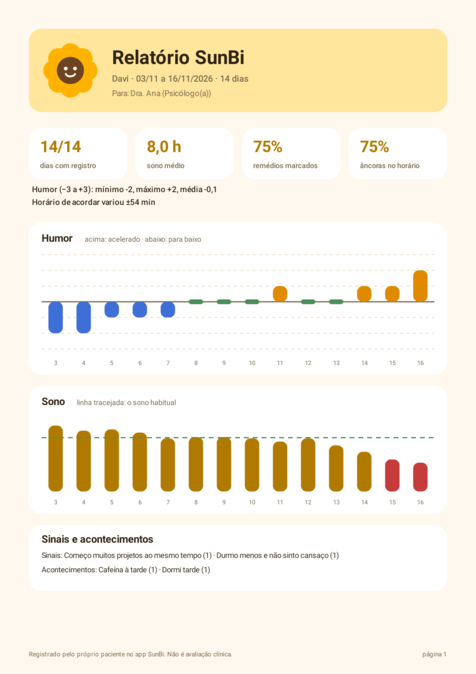
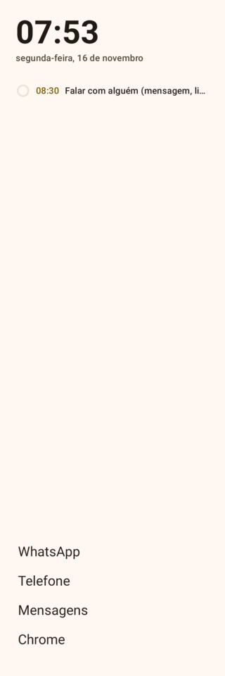
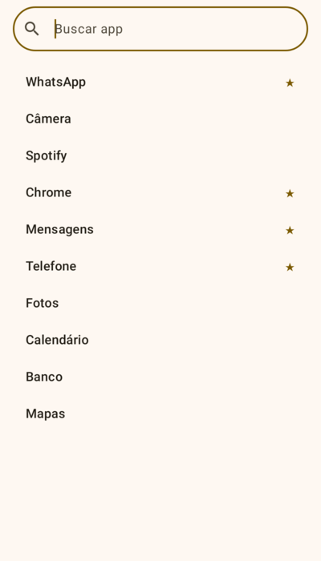
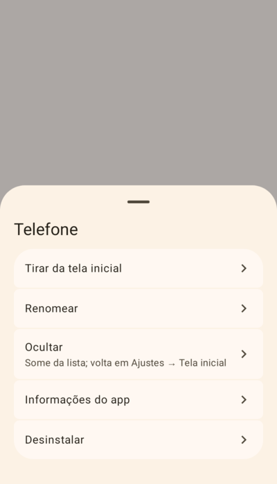

# 🌻 SunBi

**Um companheiro de rotina para pessoas com transtorno bipolar e TDAH.** Ajuda a manter o ritmo
do dia, registrar humor e sono em menos de um minuto, perceber sinais de alerta cedo, seguir o
próprio plano e começar tarefas sem travar. Funciona no celular Android, no Meta Quest 3 e no
PC (Noctalia), e tudo sincroniza entre os aparelhos da própria pessoa, sem servidor e sem conta.

> O SunBi organiza e observa. Ele **não diagnostica e não substitui** psiquiatra, psicólogo ou
> remédio. Em crise, o app mostra **CVV 188** e **SAMU 192** e o plano de segurança da pessoa.

  
  
  
  
  

---

## Para quem acompanha o paciente

Esta parte é para o psicólogo ou psiquiatra que recebe os relatórios do SunBi.

### O que a pessoa registra

Todo dia, em três passos curtos:

1. **Humor**, numa escala de **−3 (muito para baixo) a +3 (muito acelerado)**, com 0 = estável.
   É a escala do NIMH Life Chart, com os nomes escritos por extenso.
2. **Sono**: hora em que deitou e em que acordou. O app calcula as horas e compara com a mediana
   das duas últimas semanas da própria pessoa.
3. Opcionalmente **energia** e **foco** (1 a 5), **irritação** e **ansiedade** (0 a 3), os
   **sinais de alerta pessoais** que apareceram, **acontecimentos** (noite virada, álcool,
   viagem, conflito, mudança no remédio, algo bom...) e uma anotação livre.

Além do check-in, a pessoa marca as tarefas da rotina conforme faz. Cinco delas são **âncoras**
do ritmo social (levantar, primeiro contato com alguém, começar o dia, jantar, deitar), e o app
guarda o horário real em que cada âncora foi marcada. Tarefas de **remédio** contam como doses
marcadas; o app nunca sugere mudar remédio e a assistente de IA não pode mexer nelas.

### O que você recebe

Na aba **Histórico**, o botão **"Relatório para a consulta"** gera um **PDF** dos últimos 7, 14 ou
28 dias e abre a conversa de WhatsApp com você (o app já tem o seu contato se a pessoa o
cadastrou como psicólogo). O PDF traz:

- **Quatro números**: dias com registro, média de sono, doses de remédio marcadas e âncoras no
  horário (feitas a até 45 minutos do horário-alvo).
- **Gráfico de humor** no estilo Life Chart (barras para cima e para baixo do estável) e
  **gráfico de sono** com a linha do sono habitual.
- **Sinais e acontecimentos** marcados no período.
- **Dia a dia**: uma linha por dia com humor, sono, energia, irritação, ansiedade, rotina feita,
  remédios, sinais, acontecimentos e a anotação, com as marcas de folga e férias.

O relatório é o que a pessoa registrou, sem interpretação do app. Ele diz isso no rodapé:
"não é avaliação clínica".

### Como ler

- **Noites curtas com humor acima do estável e energia alta** é o padrão que o app marca como
  "sinais de subida". **Humor baixo por vários dias ou sono muito acima do normal** é "sinais de
  descida". O aviso que a pessoa vê é um convite para abrir o próprio plano, não um alerta clínico.
- **Âncoras no horário** mede a regularidade da rotina, na linha do Social Rhythm Metric
  (IPSRT). Dias de folga, feriados e férias usam uma rotina mais solta, marcada no relatório.
- **Dias sem registro não significam dias ruins.** O app foi desenhado sem culpa: nada zera,
  nada é cobrado. Se faltam dias, o relatório mostra isso.

### O que o app faz sozinho

- **Avisos gentis** quando os registros batem com os padrões acima, com cores calmas, e um
  botão para o plano da pessoa.
- **Alarmes** nos horários da rotina, sem soneca (só "Concluído" ou "Parar"), com volume que sobe
  devagar.
- **Pontos e conquistas** (abaixo) para a rotina ter um gostinho de jogo, sem punição.
- **SunAI**, uma assistente opcional, se a pessoa ligar (abaixo).

### Limites, com franqueza

Ensaios com automonitoramento por smartphone no transtorno bipolar (MONARCA, LiveWell) não
mostraram redução de recaídas por si só, e a mania é subestimada no autorrelato. Por isso o
SunBi registra também sono, energia e irritação, trata os avisos como convite para olhar o
plano e aposta no que tem mais apoio: **rotina regular, plano combinado com a equipe, adesão e
comunicação com quem trata a pessoa**. Os métodos, as evidências e as referências estão em
**[docs/METODOS.md](docs/METODOS.md)**.

### Perguntas frequentes

**Posso confiar nos horários de sono?** São os que a pessoa digitou (ou escolheu no relógio do
app). Não há sensor. O gráfico de sono mostra a variação do horário de acordar, que costuma ser
mais útil que o total.

**O que a IA vê e faz?** Só se a pessoa ligar a SunAI e aceitar: a cada pergunta, o app envia a
rotina, o plano e os registros dos últimos 31 dias para o provedor escolhido (OpenCode Go). A
SunAI resume, dá ideias e pode ajustar tarefas da rotina (sempre com "Desfazer"). Ela não vê o
relatório, não fala com você e tem regras fixas: nunca sugere mudar remédio, nunca apaga ou
muda horário de tarefa de remédio e, em sinal de risco, orienta CVV 188, SAMU 192 e o plano de
segurança.

**Onde ficam os dados?** Só nos aparelhos da pessoa (celular, Quest, PC). Não existe servidor
nem conta. O PDF sai do celular dela para o seu WhatsApp.

**Dá para ajustar a rotina junto com o paciente?** Sim. Na consulta, pelo celular (**Rotina**) ou,
com mais calma, pelo **modo complexo**: o celular serve uma página que abre no navegador do
computador com toda a configuração (rotinas, sinais, planos, pessoas, registros e backup).

---

## Como o app funciona no dia a dia

**Primeira vez: o tour.** O app não vem com rotina pronta. Oito perguntas (nome, do que cuidar,
horários de levantar e deitar, folga, remédios, o que ocupa o dia, refeições e extras) viram
duas rotinas: a de **dias de semana** e a de **folga** (fins de semana, feriados nacionais e
modo férias), com as âncoras perto uma da outra para proteger o ritmo. No fim, a pessoa pode
pedir para a **SunAI refinar**. Quem já usa o SunBi em outro aparelho só digita o código de
pareamento e recebe tudo.

  
  
  
  

| Tela | O que aparece | Um toque abre |
| --- | --- | --- |
| **Hoje** | Saudação, a faixa de **sequência e nível**, a tarefa da vez com **Concluído**, no máximo um aviso, o check-in e as tarefas pendentes | O check-in em 3 passos, as conquistas, as tarefas feitas, o editor da rotina, outros dias |
| **Histórico** | Gráfico de humor no estilo Life Chart, sono contra o seu normal e três números | O **relatório em PDF**, que já abre o WhatsApp do psicólogo |
| **SunAI** | Conversa com a assistente: como foi a semana ou o mês, conselhos e ajustes na rotina | Chave, modelo e apagar a conversa |
| **Plano** | O botão **Preciso de ajuda agora** e uma lista curta | Sinais de alerta, o que fazer quando o humor sobe ou desce, plano de segurança, pessoas |
| **Ajustes** (engrenagem) | Cores, sons e vibração, alarmes | A rotina, a SunAI, a sincronização, o **modo complexo** e a **tela inicial** |

**Modo férias:** toque na flor em **Hoje**. Ela coloca óculos escuros e o app passa a usar a
rotina de folga. Toque de novo para voltar.

**Bloco de foco (TDAH):** segurar uma tarefa abre um cronômetro de 5 minutos (o difícil é
começar), com o primeiro passo da tarefa em destaque.

**Dia difícil:** quando o humor do check-in vem **para baixo** (−2 ou −3), o app pergunta uma vez
se a pessoa quer deixar o dia **só com o essencial**: âncoras e remédios. O resto espera, sem
culpa. Enquanto vale, um selo pequeno em Hoje avisa e, com um toque, volta à rotina inteira.

**Lembretes e companhia:**

- **Widget** de tela inicial com a tarefa da vez, o botão Concluído e a sequência, para quem
  não usar o launcher.
- **Lembrete de check-in às 21h**, só se o dia ainda não tiver registro (desligável).
- **Resumo da semana pela SunAI** no domingo às 19h, por notificação (opcional, na SunAI).
- **Alarmes só num aparelho:** em Ajustes, "Os alarmes tocam em: só neste" silencia o Quest e
  o PC e deixa o celular tocar.
- **Sono do relógio:** no check-in, "Puxar do relógio" copia a noite do Health Connect
  (só leitura, só quando a pessoa pede).

### Pontos e conquistas, sem culpa

Inspirado no Duolingo, mas desenhado para quem tem oscilação de humor:

- **XP**: 10 por tarefa, 20 pelo check-in, 30 pela rotina inteira, 15 pelas âncoras no horário.
- **Níveis** com nome de girassol (Semente, Broto, Muda, Botão, Girassol...).
- **Sequência de dias** com atividade. **Dia de folga sem nada não quebra** a sequência, e nada
  é perdido quando ela recomeça.
- **14 conquistas**: primeiro registro, semana registrada, remédios em dia, ritmo certinho, plano
  pronto, três dias seguidos... Cada uma é comemorada uma vez, com confete.
- Tudo é calculado a partir dos registros que já existem, então os três aparelhos mostram os
  mesmos números.

### Visual e sensação

Material 3 Expressive (formas, movimento com mola, botões conectados, indicadores ondulados),
tema claro e escuro, cores dinâmicas do sistema (Material You) e ícone adaptativo com versão
monocromática. Cada ação tem **som curto e vibração com forma própria**: marcar uma tarefa sobe e
estala, desmarcar cai, fechar o dia é um acorde, uma conquista gira. Tudo desligável em Ajustes.
No Quest e em telas largas, a navegação vira um trilho lateral.

### Tela inicial (modo launcher)

Em **Ajustes → Tela inicial**, o SunBi pode virar a tela inicial do telefone, no espírito dos
launchers minimalistas, e de propósito quase vazio: relógio, data, **uma linha com a tarefa da
vez** (um toque marca como feita) e até oito apps favoritos **em texto**, sem grade de ícones.
Deslizar para cima abre todos os apps, com busca que ignora acentos e abre sozinha quando sobra
um só resultado. Segurar um app abre as opções: pôr na tela inicial, **renomear**, **ocultar**,
informações e desinstalar. A flor, embaixo, abre o SunBi. Mesmas cores, formas, sons e vibrações
do app; o papel de parede aparece por trás de um véu da cor do tema.

  
  
  

### Modo complexo

Para configurar tudo com calma pelo computador: em **Ajustes → Modo complexo**, o celular passa
a servir uma página na rede local, protegida por um PIN de seis dígitos. Nela dá para editar as
duas rotinas em tabela, os sinais, os sete blocos do plano, as pessoas, os registros dos últimos
dias e os ajustes, e exportar ou importar um backup. Cinco PINs errados desligam o modo.

## Base científica, em resumo

| Método | No SunBi |
| --- | --- |
| Terapia Interpessoal e de Ritmo Social (IPSRT) e Social Rhythm Metric | Cinco âncoras da rotina e a métrica "âncoras no horário (±45 min)" |
| NIMH Life Chart Method | Check-in de humor −3 a +3, sono, energia, irritação, ansiedade; gráfico de humor |
| Psicoeducação (Programa de Barcelona) | Sinais de alerta pessoais, plano para subida e descida, acontecimentos, adesão |
| Sono e ritmo circadiano | Horários de deitar e acordar, comparação com o normal da pessoa, aviso de noites curtas |
| Plano de segurança de Stanley e Brown | Botão "Preciso de ajuda agora", seis passos editáveis, pessoas, CVV e SAMU |
| TCC para TDAH em adultos (Safren) e Terapia Metacognitiva (Solanto) | Lembretes externos, primeiro passo de cada tarefa, cartão "Agora", bloco de foco |
| Ativação comportamental | Tarefas pequenas e agendadas; "uma coisa pequena e boa por dia" no plano de descida |

Detalhes, limites e referências: **[docs/METODOS.md](docs/METODOS.md)**.

## Privacidade e segurança

- Os dados ficam **só nos aparelhos da pessoa**. A sincronização é direta, na rede de casa,
  protegida por um código de pareamento; fora de casa, Tailscale ou WireGuard.
- A **SunAI** só funciona com a chave da própria pessoa e depois de um consentimento explícito
  que diz o que é enviado. A chave e a conversa ficam só no aparelho.
- O **modo complexo** só responde com o modo ligado e com o PIN; é HTTP na rede local, para
  ligar só enquanto usa.
- O app não tem conta, não tem anúncios, não coleta nada. Código aberto sob a licença MIT.

## Instalar

- **Celular e Quest:** baixe o `sunbi.apk` na aba **Releases** e instale por cima da versão
  anterior (mesma chave de assinatura).
- **PC (Noctalia):** plugin em `noctalia/sunbi/`, sem daemon.
- Pareamento, modo complexo, limitações, desenvolvimento e publicação de versões:
  **[docs/INSTALACAO.md](docs/INSTALACAO.md)**. Protocolo de sincronização:
  **[docs/PROTOCOL.md](docs/PROTOCOL.md)**.

## Partes do projeto

| Parte | Pasta |
| --- | --- |
| App Android / Quest (Kotlin, Jetpack Compose, Material 3 Expressive) | `android/` |
| Plugin Noctalia v5 (Luau, roda inteiro no plugin) | `noctalia/sunbi/` |
| Métodos e referências | `docs/METODOS.md` |
| Protocolo P2P | `docs/PROTOCOL.md` |
| Instalação e desenvolvimento | `docs/INSTALACAO.md` |
