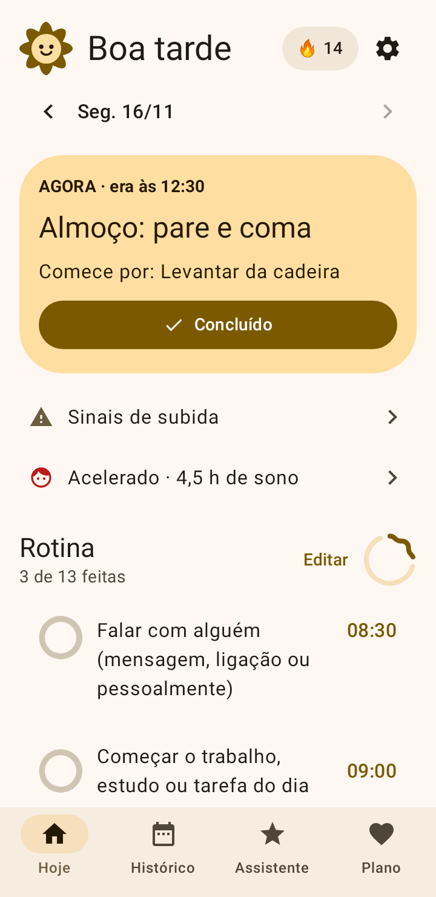
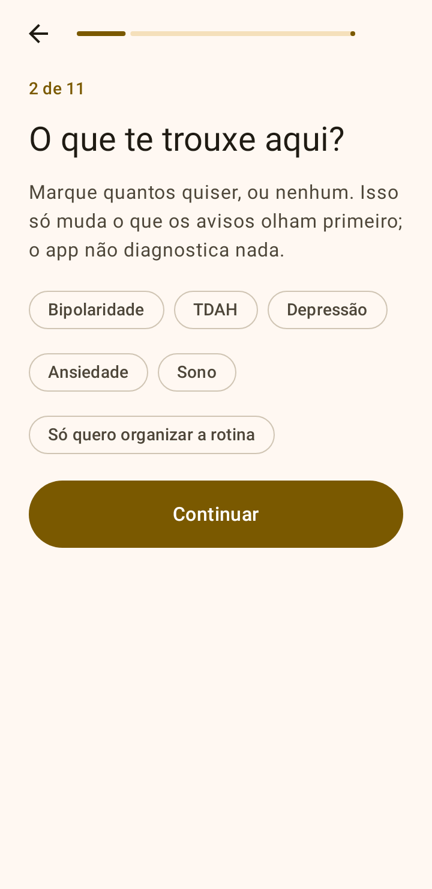
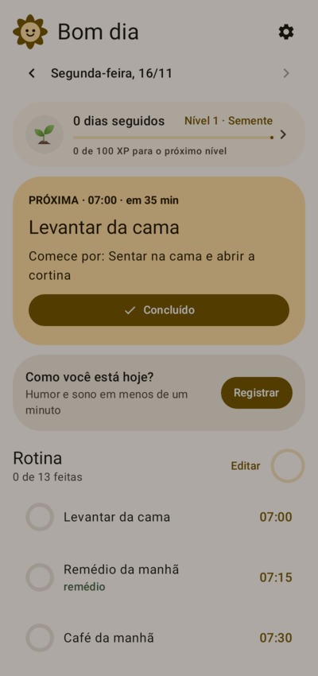
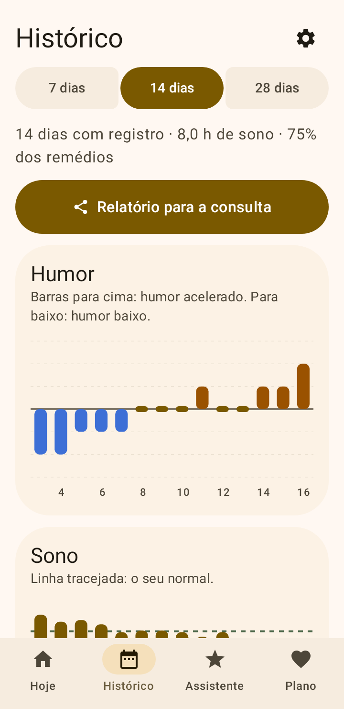
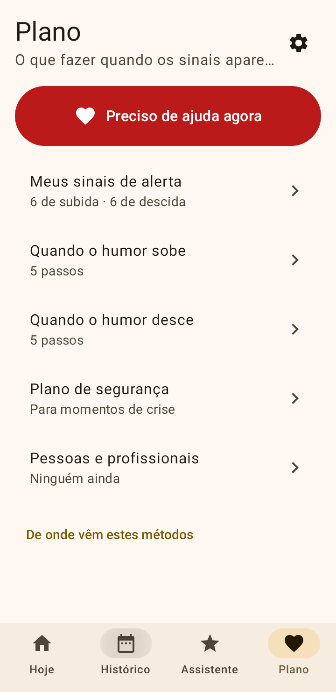
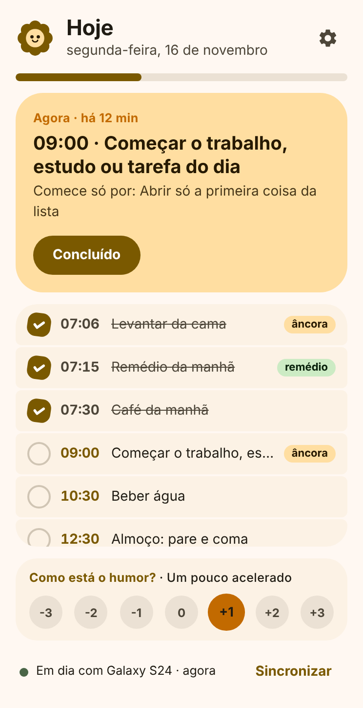
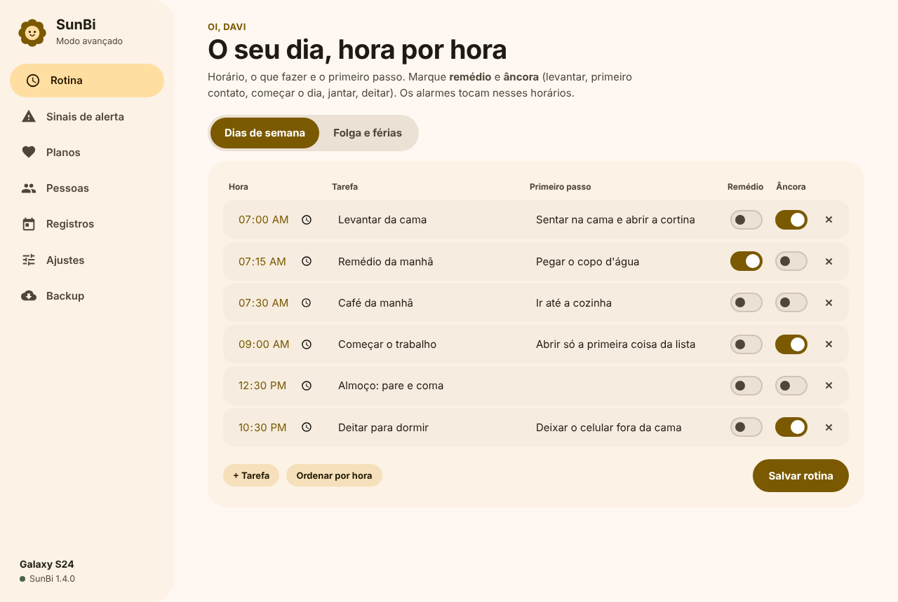

# 🌻 SunBi

**Um companheiro de rotina, pensado com cuidado para quem vive com transtorno bipolar, TDAH,
depressão ou ansiedade, e útil para qualquer pessoa que queira dias mais regulares.**

O SunBi lembra você do que fazer em cada hora do dia, guarda como você está em menos de um
minuto e ajuda a perceber cedo quando o humor começa a mudar. É gratuito, não tem anúncios e
não pede cadastro.

> O SunBi organiza e observa. Ele **não diagnostica e não substitui** médico, psicólogo ou
> remédio. Em crise, ligue **188 (CVV)** ou **192 (SAMU)**.

  
  
  
  
  

## O que ele faz

- **Monta a sua rotina.** Você responde onze perguntas simples (que horas acorda, quando é a
  sua folga, se toma remédio, o que ocupa o seu dia) e o app cria a rotina. Nenhuma pergunta
  exige um diagnóstico, e dá para mudar tudo depois.
- **Avisa na hora certa.** Um alarme para cada tarefa, com som suave. Não tem soneca: ou você
  fez, ou você para o alarme.
- **Mostra uma coisa de cada vez.** A tela principal mostra só a tarefa de agora e o primeiro
  passo para começar ("calçar o tênis").
- **Guarda como você está.** Uma vez por dia você marca o humor e o sono. Leva menos de um minuto.
- **Percebe mudanças.** Se você dorme pouco e está acelerado, ou está para baixo há vários dias,
  o app avisa com calma e mostra o plano que você mesmo escreveu.
- **Prepara a consulta.** Um botão gera um relatório em PDF e abre o WhatsApp do seu psicólogo.
- **Ajuda na hora difícil.** O botão **Preciso de ajuda agora** mostra o seu plano de
  segurança, as suas pessoas de confiança, o CVV e o SAMU.
- **Não cobra.** Pontos e conquistas só somam. Um dia sem registro não apaga nada.

## Instalar no celular (Android)

1. Abra a página **[Releases](../../releases)** e baixe o arquivo **`sunbi.apk`**.
2. Toque no arquivo baixado. Se o celular perguntar, permita instalar.
3. Abra o SunBi e responda as perguntas. Pronto.

Na primeira vez o app pede algumas permissões (notificações e alarmes). Aceite: sem elas os
alarmes não tocam. Se faltar alguma, um aviso vermelho aparece em **Ajustes** com o atalho
para resolver.

Para atualizar, baixe o `sunbi.apk` novo e instale por cima. Nada é apagado.

## Como usar no dia a dia

O app tem quatro abas embaixo:

| Aba | Para que serve |
| --- | --- |
| **Hoje** | A tarefa de agora, com o botão **Concluído**, e o registro do dia |
| **Histórico** | Seus gráficos de humor e sono, e o relatório para a consulta |
| **Assistente** | Uma conversa com uma inteligência artificial. Só aparece se você quiser (veja abaixo) |
| **Plano** | O botão de ajuda, seus sinais de alerta e o que fazer quando o humor sobe ou desce |

A engrenagem, no alto, abre os **Ajustes**.

Algumas coisas que vale conhecer:

- **Dia de folga.** Fins de semana e feriados usam uma rotina mais solta, sozinhos.
- **Férias.** Toque na flor, na aba Hoje. Ela põe óculos escuros e a rotina de folga vale até
  você tocar de novo.
- **Dia difícil.** Se você marcar o humor bem para baixo, o app oferece deixar o dia só com o
  essencial: remédios e os horários mais importantes.
- **Travou para começar?** Segure o dedo numa tarefa. Abre um cronômetro de 5 minutos, só para
  dar o primeiro passo.
- **Barra de baixo mais limpa.** Em Ajustes → Aparência e sons dá para esconder os nomes das abas.

## No computador

Com a **extensão do SunBi** no navegador, a rotina aparece também no computador: ela mostra a
tarefa de agora, deixa marcar como feita e **avisa na hora de cada tarefa**, mesmo com a
janela fechada.

  

1. Baixe o **`sunbi-extensao.zip`** na página **[Releases](../../releases)** e descompacte numa pasta.
2. No Chrome, Edge ou Brave, abra `chrome://extensions`, ligue o **Modo do desenvolvedor**,
   clique em **Carregar sem compactação** e escolha a pasta.
3. No celular, abra **Ajustes → Sincronização**. O cartão **Conectar o computador** mostra um
   **endereço** e um **código**.
4. Clique na flor no navegador e digite os dois.

O celular e o computador precisam estar no mesmo Wi-Fi. Se o celular ficar um tempo fora da
rede, nada se perde: os dois se acertam quando ele voltar.

## A assistente (opcional)

O SunBi tem uma assistente de inteligência artificial. Ela resume a sua semana, dá ideias e
pode ajustar a rotina quando você pede. Você escolhe **como chamar** ela.

**Você decide se quer.** O app pergunta na primeira vez, e quem responde "Não quero IA" não vê
a aba nem recebe convites. Para ligar ou desligar depois: **Ajustes → Assistente de IA**.

Se quiser usar, ela precisa de uma **chave** de um serviço de IA, que você cria
no site do serviço. O app aceita **OpenAI**, **OpenRouter**, **OpenCode Go**, **Groq**,
**DeepSeek** e outros parecidos. Esses serviços costumam cobrar pelo uso.

Para sua segurança, a assistente **nunca mexe nos seus remédios**, e tudo o que ela muda na
rotina pode ser desfeito com um toque.

## Seus dados são seus

- Tudo fica **no seu celular**. Não existe conta nem servidor do SunBi.
- O celular e o computador conversam **direto um com o outro**, pelo Wi-Fi da sua casa.
- A assistente só recebe os seus registros se você ligar e aceitar. Aí eles vão para o serviço
  de IA que você escolheu. Com a IA desligada, nada é enviado.
- O relatório só sai do seu celular quando você manda.
- O código do app é aberto: qualquer pessoa pode conferir o que ele faz.

## Dúvidas comuns

**Funciona no iPhone?** Não. Só em Android.

**Preciso de internet?** Não para o dia a dia. Só a assistente usa internet.

**O alarme não tocou.** Abra Ajustes. Se houver um aviso vermelho de permissões, toque nele.
Alguns celulares também "dormem" os apps para economizar bateria: nas configurações do
Android, deixe o SunBi sem restrição de bateria.

**Troquei de celular.** No celular antigo, ligue **Ajustes → Modo avançado**, abra o endereço
que ele mostra no navegador do computador e baixe o **backup**. No celular novo, faça o mesmo
e importe o arquivo.

**Posso mudar a rotina depois?** Sim, a qualquer hora, em Hoje → Editar. Para mexer em tudo
com calma numa tela grande, existe o **modo avançado**, que abre no navegador do computador.

  

**Sou psicólogo ou psiquiatra e recebi um relatório.** Leia
**[Para quem acompanha o paciente](docs/PARA-PROFISSIONAIS.md)**.

## Quer saber mais?

| Assunto | Onde |
| --- | --- |
| Para profissionais de saúde | [docs/PARA-PROFISSIONAIS.md](docs/PARA-PROFISSIONAIS.md) |
| Os métodos por trás do app e as pesquisas | [docs/METODOS.md](docs/METODOS.md) |
| Instalação em detalhes, Firefox, tela inicial, limitações | [docs/INSTALACAO.md](docs/INSTALACAO.md) |
| A extensão do navegador | [extension/README.md](extension/README.md) |
| Como os aparelhos conversam (para programadores) | [docs/PROTOCOL.md](docs/PROTOCOL.md) |

SunBi é um projeto de código aberto, sob a licença MIT.
